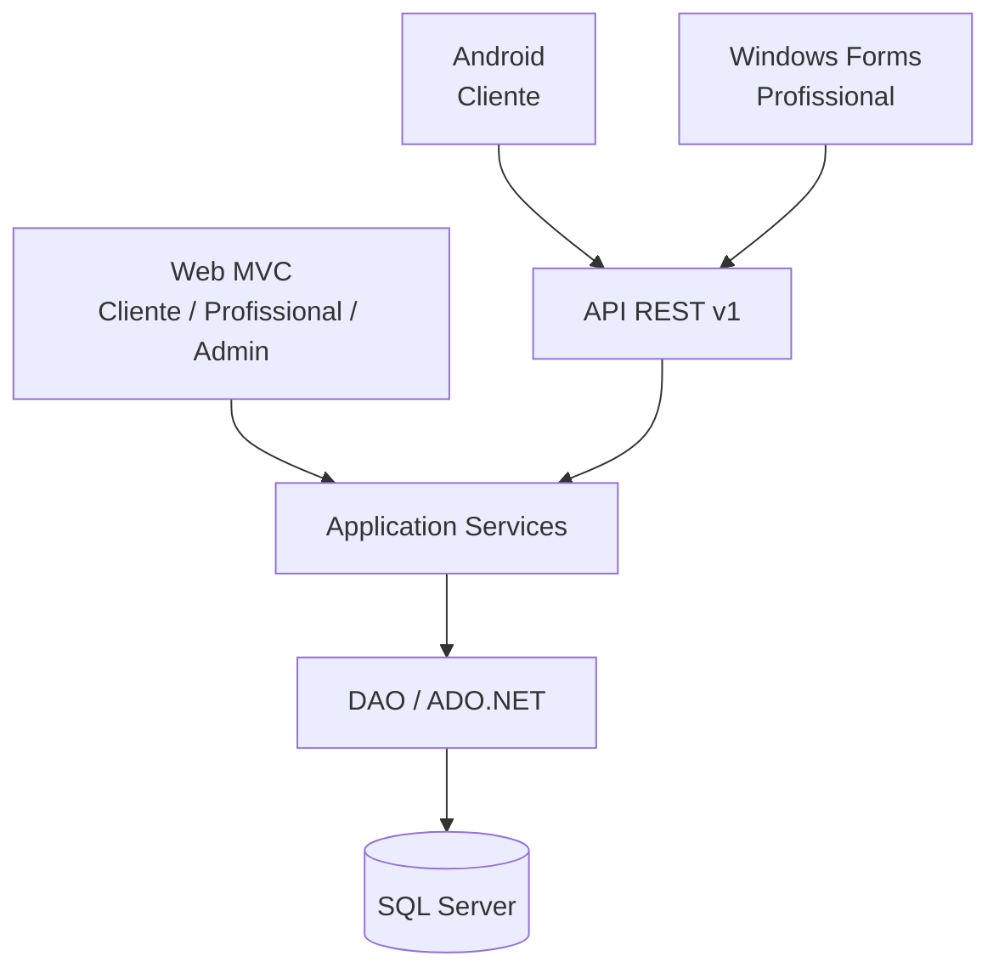

# TRAMPO

Plataforma integrada para contratação e gerenciamento de serviços entre clientes e profissionais.

O **TRAMPO** foi desenvolvido como projeto acadêmico do **PIM IV do curso de Análise e Desenvolvimento de Sistemas** e é composto por três aplicações integradas:

| Aplicação | Tecnologia | Público principal |
| --- | --- | --- |
| Web | ASP.NET Core MVC / C# | Cliente, Profissional e Administrador |
| Android | Kotlin + XML | Cliente |
| Desktop | Windows Forms / C# | Profissional |

As aplicações utilizam o mesmo backend e compartilham as regras de negócio e os dados do sistema.

---

## Sobre o projeto

O TRAMPO tem como objetivo facilitar a conexão entre clientes que procuram serviços e profissionais que desejam divulgar e administrar seus atendimentos.

A solução permite que clientes pesquisem serviços, realizem agendamentos, acompanhem solicitações e avaliem atendimentos.

Profissionais podem cadastrar serviços, informar disponibilidade, gerenciar locais de atendimento e acompanhar os agendamentos recebidos.

Administradores possuem acesso à área Web para acompanhamento e administração da plataforma.

---

## Aplicações do ecossistema

### Web

A aplicação Web é a interface mais completa do TRAMPO.

Atende os perfis:

- Cliente;
- Profissional;
- Administrador.

Principais recursos:

- cadastro e login;
- perfil de cliente e profissional;
- catálogo de serviços;
- busca de serviços;
- agendamentos;
- histórico de agendamentos;
- avaliações;
- disponibilidade de horários;
- gerenciamento de serviços;
- gerenciamento de locais;
- notificações;
- plano premium;
- dashboard profissional;
- painel administrativo;
- recursos de acessibilidade.

### Android

O aplicativo Android é direcionado principalmente ao **Cliente**.

Principais recursos:

- cadastro e autenticação;
- edição de perfil;
- alteração de senha;
- busca e catálogo de serviços;
- filtros por modalidade;
- consulta de profissionais;
- consulta de categorias e subcategorias;
- criação de agendamentos;
- acompanhamento de agendamentos;
- confirmação de conclusão;
- avaliações;
- notificações;
- suporte.

O aplicativo Android não acessa diretamente o banco de dados.

A comunicação ocorre através da API REST do TRAMPO.

### Desktop

A aplicação Desktop foi desenvolvida em **Windows Forms** e é direcionada ao **Profissional**.

Principais recursos:

- login profissional;
- consulta de agendamentos recebidos;
- visualização do detalhe do atendimento;
- confirmação de agendamento;
- recusa de agendamento;
- finalização de atendimento;
- listagem de serviços próprios;
- cadastro de serviços;
- edição de serviços;
- remoção/desativação de serviços;
- gerenciamento de locais;
- consulta de CEP.

Assim como o Android, o Desktop não acessa diretamente o SQL Server.

Toda comunicação é realizada através da API REST.

---

## Arquitetura

A solução utiliza uma arquitetura integrada.



A aplicação Web utiliza ASP.NET Core MVC.

Android e Windows Forms funcionam como clientes da API REST.

As regras de negócio permanecem centralizadas no backend.

A persistência é realizada por meio da camada DAO utilizando ADO.NET.

---

## Perfis de usuário

### Cliente

Pode utilizar:

- Web;
- Android.

Entre suas funcionalidades estão:

- consultar serviços;
- realizar agendamentos;
- acompanhar solicitações;
- confirmar conclusão;
- avaliar profissionais;
- editar perfil;
- consultar notificações;
- solicitar suporte.

### Profissional

Pode utilizar:

- Web;
- Desktop Windows Forms.

Entre suas funcionalidades estão:

- cadastrar serviços;
- editar serviços;
- administrar disponibilidade;
- cadastrar locais;
- acompanhar agendamentos recebidos;
- confirmar solicitações;
- recusar solicitações;
- finalizar atendimentos.

### Administrador

Utiliza a aplicação Web.

Possui acesso às funcionalidades administrativas e de gerenciamento da plataforma.

---

## Tecnologias

### Backend e Web

- C#
- .NET 10
- ASP.NET Core MVC
- ASP.NET Core Web API
- Razor Views
- HTML
- CSS
- JavaScript
- ADO.NET
- JWT Bearer
- Session
- OpenAPI / Swagger

### Banco de dados

- SQL Server
- SQL Server Express em desenvolvimento
- scripts SQL versionados

### Android

- Kotlin
- XML
- Android Views
- ViewModel
- Repository
- Retrofit
- JWT Bearer

### Desktop

- C#
- .NET 10
- Windows Forms
- HttpClient
- System.Text.Json
- async/await
- JWT Bearer

### DevOps

- Git
- GitHub
- GitHub Actions
- scripts PowerShell
- build e testes automatizados

---

## Banco de Dados

O sistema utiliza SQL Server.

Entre as principais entidades estão:

- usuários;
- clientes;
- profissionais;
- categorias;
- subcategorias;
- serviços;
- locais;
- disponibilidades;
- agendamentos;
- endereços de agendamento;
- avaliações;
- notificações;
- assinaturas premium.

A camada de persistência utiliza DAO com ADO.NET.

Android e Desktop não possuem conexão direta com o banco.

---

## API REST

A API permite a integração das aplicações externas com o backend.

Exemplos de áreas disponíveis:

```text
/api/v1/auth
/api/v1/perfil
/api/v1/servicos
/api/v1/agendamentos
/api/v1/locais
/api/v1/enderecos
/api/v1/categorias
/api/v1/notificacoes
/api/v1/suporte
```

Endpoints protegidos utilizam autenticação JWT Bearer.

O backend é responsável por:

- autenticação;
- autorização;
- validação;
- ownership;
- regras de negócio;
- persistência;
- consistência dos dados.

---

## Segurança

Foram adotadas medidas como:

- armazenamento seguro de senhas;
- autenticação por sessão na aplicação Web;
- JWT Bearer para Android e Desktop;
- autorização por perfil;
- validação de propriedade dos recursos;
- proteção antiforgery nas operações Web;
- validação de transições de estado;
- rate limiting no login da API;
- configuração de secrets fora do código-fonte;
- tratamento centralizado de erros.

O token utilizado pelas aplicações clientes não contém credenciais de banco de dados.

No Desktop, o JWT é mantido apenas em memória durante a sessão.

---

## Acessibilidade

A aplicação Web possui recursos voltados à acessibilidade, incluindo:

- integração com VLibras;
- labels semânticas;
- navegação estruturada;
- inputs acessíveis;
- atributos ALT em imagens importantes;
- melhoria de contraste e responsividade.

---

## Endereços e CEP

O sistema possui suporte a endereços estruturados.

Entre os dados utilizados estão:

- CEP;
- logradouro;
- número;
- complemento;
- bairro;
- cidade;
- UF.

A consulta de CEP é realizada pelo backend.

As aplicações clientes não acessam diretamente serviços externos de CEP.

---

## Imagens

### Aplicação Web


### Android

As evidências do aplicativo Android ficam documentadas no repositório Mobile e na pasta de evidências do projeto principal.

Exemplos:

```text
docs/evidencias/mobile-home.png
docs/evidencias/mobile-notificacoes.png
docs/evidencias/mobile-suporte.png
```

### Windows Forms

As evidências do Desktop devem ser publicadas somente após revisão de privacidade.

Exemplos de telas:

```text
Login
Painel principal
Agendamentos
Serviços
Locais
```

---

## Estrutura do projeto principal

```text
Trampo/
│
├── Api/
│   └── Contracts/
│
├── Controllers/
│   ├── Api/
│   └── ...
│
├── Models/
├── ViewModels/
├── Services/
├── DAO/
├── Views/
│
├── wwwroot/
│   ├── css/
│   ├── js/
│   └── assets/
│
├── Scripts/
├── ScriptsSQL/
├── Tests/
├── docs/
├── .github/
│   └── workflows/
│
├── Program.cs
├── appsettings.json
└── README.md
```

---

## Organização das camadas

### Controllers

Recebem as requisições da aplicação Web ou API e encaminham as operações para as camadas responsáveis.

### Services

Concentram regras de aplicação e coordenam operações de negócio.

### DAO

Responsável pelo acesso ao SQL Server utilizando ADO.NET.

### Models

Representam as entidades principais do sistema.

### ViewModels

Transportam dados específicos entre Controllers e Views.

### Views

Interfaces Razor utilizadas pela aplicação Web.

### API Contracts

Definem os contratos utilizados na comunicação REST.

---

## Repositórios

O TRAMPO é dividido em três repositórios.

### Web / Backend / API

Este é o repositório principal.

Contém:

- aplicação ASP.NET Core MVC;
- API REST;
- Services;
- DAO;
- SQL;
- testes;
- documentação principal do PIM.

Repositório:

```text
https://github.com/vinicimxt/Trampo
```

### Android

Aplicativo destinado principalmente ao Cliente.

Repositório:

```text
https://github.com/vinicimxt/TRAMPO-APP
```

### Windows Forms

Aplicação Desktop destinada ao Profissional.

Repositório:

```text
https://github.com/vinicimxt/Trampo-Desktop
```

---

## Como executar

### 1. Clonar o projeto

```bash
git clone https://github.com/vinicimxt/Trampo.git
cd Trampo
```

### 2. Preparar o banco

Utilize os scripts disponíveis no projeto.

Execute primeiro o script principal de criação do banco e depois as migrações incrementais necessárias presentes em:

```text
ScriptsSQL/
```

Utilize um banco local de desenvolvimento.

> Atenção: scripts de reconstrução de banco devem ser executados apenas em ambiente local/descartável.

### 3. Configurar a conexão

Durante o desenvolvimento é possível utilizar SQL Server Express com autenticação integrada do Windows.

Exemplo:

```text
Server=localhost\SQLEXPRESS;
Database=Xamou;
Trusted_Connection=True;
TrustServerCertificate=True;
```

Não armazene credenciais reais no repositório.

### 4. Configurar JWT para desenvolvimento

A chave JWT deve ficar fora do código-fonte.

Utilize .NET User Secrets ou variável de ambiente.

Exemplo:

```powershell
dotnet user-secrets set "Jwt:SigningKey" "SUA_CHAVE_LOCAL"
```

### 5. Executar

Uma opção é utilizar o script de desenvolvimento:

```powershell
powershell -ExecutionPolicy Bypass -File Scripts/Start-Dev.ps1
```

Ou:

```bash
dotnet run --urls "http://0.0.0.0:5165"
```

A URL local padrão utilizada durante o desenvolvimento é:

```text
http://localhost:5165/
```

Swagger está disponível somente quando habilitado no ambiente de desenvolvimento.

---

## Executando o Android

Clone o repositório Android:

```bash
git clone https://github.com/vinicimxt/TRAMPO-APP.git
```

Abra o projeto no Android Studio.

Durante o desenvolvimento com o Android Emulator, o endereço utilizado para acessar a API local é:

```text
http://10.0.2.2:5165/
```

A configuração Release exige uma URL HTTPS válida.

---

## Executando o Desktop

Clone o repositório Windows Forms.

Abra a solução no Visual Studio ou execute:

```powershell
dotnet restore Trampo.Desktop.slnx
dotnet build Trampo.Desktop.slnx
dotnet run --project Trampo.Desktop/Trampo.Desktop.csproj
```

Por padrão, o Desktop utiliza:

```text
http://localhost:5165/
```

A URL também pode ser configurada através da variável:

```text
TRAMPO_API_BASE_URL
```

---

## Testes

O projeto possui verificações automatizadas para diferentes partes da solução.

São avaliados aspectos como:

- autenticação;
- autorização;
- ownership;
- contratos da API;
- agendamentos;
- serviços;
- locais;
- endereços;
- segurança;
- integração;
- comportamento do Desktop;
- comportamento do Android.

O Desktop possui também um projeto próprio de testes não visuais.

---

## Integração Contínua

O projeto utiliza GitHub Actions.

Existem workflows separados para:

- Backend / Web;
- Android;
- Windows Forms.

Cada aplicação possui necessidades diferentes de ambiente.

O Desktop utiliza runner Windows devido ao uso de Windows Forms.

O backend não depende do pipeline do aplicativo Android ou Desktop.

---

## Cloud

A arquitetura foi preparada para configuração por ambiente e futura implantação em Cloud.

Foram realizadas melhorias como:

- externalização de configuração;
- endpoint de health check;
- build Release;
- documentação de implantação;
- separação entre Development e Production.

Não é afirmado neste projeto que exista um deploy público de produção caso ele não tenha sido efetivamente realizado.

---

## DevOps

Foram utilizados:

- Git;
- GitHub;
- GitHub Actions;
- branches e commits;
- workflows de build;
- testes automatizados;
- scripts locais;
- documentação de implantação.

---

## Desenvolvimento acadêmico

O projeto foi desenvolvido de forma incremental.

Entre as principais evoluções realizadas estão:

- revisão de segurança e autorização;
- melhoria de integridade dos agendamentos;
- separação das regras em Application Services;
- criação da API REST;
- autenticação JWT;
- estruturação de endereços;
- integração de CEP;
- desenvolvimento do aplicativo Android;
- implantação de workflows de CI;
- preparação para Cloud;
- melhorias de interface Web e Mobile;
- ampliação das funcionalidades Mobile;
- desenvolvimento da aplicação Windows Forms;
- documentação e testes finais.

---

## Documentação

A documentação técnica e acadêmica está disponível em:

```text
docs/
```

Entre os documentos estão:

```text
PIM-REQUISITOS.md
ARQUITETURA-FINAL.md
BANCO-DE-DADOS.md
API-FINAL.md
MATRIZ-WEB-API-MOBILE.md
DEVOPS-E-CLOUD.md
AGIL.md
SEGURANCA-FINAL.md
TESTES-FINAIS.md
ROTEIRO-APRESENTACAO.md
EVIDENCIAS-CHECKLIST.md
SPRINT-12-DESKTOP.md
```

---

## Limitações atuais

A solução acadêmica possui algumas limitações conhecidas.

Entre elas:

- não há publicação oficial na Play Store;
- não há deploy Cloud público confirmado;
- Desktop é destinado ao perfil Profissional;
- Android é destinado principalmente ao Cliente;
- Administrador utiliza a aplicação Web;
- não há pagamento online implementado;
- não há chat em tempo real;
- não há mapas/GPS integrados;
- Desktop não possui banco local;
- Android e Desktop dependem da API.

---

## Contexto acadêmico

O TRAMPO foi desenvolvido como parte do **Projeto Integrado Multidisciplinar (PIM IV)** do curso de **Análise e Desenvolvimento de Sistemas**.

O projeto demonstra a integração entre:

- desenvolvimento Web;
- desenvolvimento Mobile;
- desenvolvimento Desktop;
- APIs REST;
- banco de dados;
- orientação a objetos;
- segurança;
- acessibilidade;
- metodologia ágil;
- DevOps;
- preparação para Cloud.

---

## Autores

Projeto acadêmico desenvolvido pelos integrantes do grupo do PIM IV.
