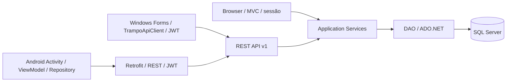

# TRAMPO

Projeto acadêmico de Análise e Desenvolvimento de Sistemas — **PIM IV**. Plataforma para aproximar clientes e profissionais, descobrir serviços e organizar agendamentos. A entrega reúne Web ASP.NET Core, API REST, aplicativo Android nativo e Desktop Windows Forms em C#.

O problema abordado é a fragmentação entre encontrar um serviço, consultar horários e acompanhar o atendimento. TRAMPO demonstra esse fluxo num protótipo integrado; não representa operação comercial, cobrança real ou deploy cloud já realizado.

## Funcionalidades e perfis

- **Cliente Web/Android:** cadastro, login/logout, perfil, senha, catálogo e busca, detalhe, agenda, agendamento/cancelamento, confirmação de conclusão, avaliação, notificações internas e suporte.
- **Profissional Web:** serviços, locais, disponibilidade, dashboard e atendimento das solicitações. Plano Free/Premium com checkout simulado.
- **Profissional Desktop (Windows Forms):** login, agendamentos, serviços e locais com consulta de CEP pela API.
- **Admin Web:** dashboard e indicadores protegidos por perfil.

Android tem foco Cliente; Desktop tem foco Profissional. Admin usa Web. O Android não oferece área Profissional/Admin. [Matriz completa](docs/MATRIZ-WEB-API-MOBILE.md).

## Arquitetura e tecnologias



Backend: C#, .NET 10, MVC/Razor, API REST, ADO.NET, JWT Bearer, sessão/antiforgery, OpenAPI e health check. Alguns módulos MVC legados ainda chamam DAOs diretamente.

Android: Kotlin, XML/Views, ViewModel/Repository, Retrofit/OkHttp, tema TRAMPO/DayNight. Projeto separado: [TRAMPO-APP](https://github.com/vinicimxt/TRAMPO-APP). Sem Compose ou banco local como fonte principal.

Desktop: C#/.NET 10, Windows Forms e cliente HTTP assíncrono. Projeto separado: `Trampo.Desktop`. JWT somente em memória; sem SQL ou banco local. [Fechamento Desktop](docs/SPRINT-12-DESKTOP.md).

[Arquitetura atual e proposta cloud](docs/ARQUITETURA-FINAL.md) · [API — 32 operações](docs/API-FINAL.md) · [Banco e MER](docs/BANCO-DE-DADOS.md).

## Executar localmente

Pré-requisitos: SDK .NET definido em [global.json](global.json) (10.0.401/latestPatch), SQL Server/SQL Express e, para Mobile, Android Studio/JBR compatível, SDK 37 e emulador. Os scripts de integração locais usam PowerShell/Windows e SQL com autenticação integrada.

1. Clone este repositório. Para banco **novo**, revise e execute [ScriptBD.txt](ScriptBD.txt), seguido de [migração 001](ScriptsSQL/001_enderecos_geolocalizacao.sql). O script base cria `Xamou` e não é idempotente. Em banco existente, não recrie: verifique/aplique somente a migração necessária.
2. Configure `ConnectionStrings:Xamou` em User Secrets/ambiente se a instância local diferir da configuração Development. Não coloque senha SQL em arquivo versionado.
3. Configure `Jwt:SigningKey` em User Secrets ou `Jwt__SigningKey` no ambiente, Base64 de pelo menos 32 bytes aleatórios. Não imprimir ou versionar. O script de inicialização reutiliza a chave configurada. Sem chave, login API fica indisponível.
4. Execute na raiz:

```powershell
dotnet restore
powershell -NoProfile -ExecutionPolicy Bypass -File Scripts/Start-Dev.ps1
```

Web/API local: `http://localhost:5165`; emulador Debug: `http://10.0.2.2:5165/`. Perfil HTTPS local também existe em launchSettings; HTTP é configuração de demonstração Debug. Abra o projeto Android separado no Android Studio e execute a variante Debug. Para o Desktop, abra `Trampo.Desktop.slnx` no Windows e execute `dotnet run --project Trampo.Desktop/Trampo.Desktop.csproj` no diretório do projeto Desktop; `TRAMPO_API_BASE_URL` permite configurar a URL da API.

OpenAPI/Swagger somente Development: `/openapi/v1.json` e `/swagger/index.html`. `/health` verifica apenas o processo, não o banco. Para instruções de ambiente e implantação futura, consulte [IMPLANTACAO](docs/IMPLANTACAO.md).

## Banco, endereços e segurança

15 tabelas, chaves/constraints e migração incremental para componentes de endereço/snapshots. CEP pode ser consultado via ViaCEP ou preenchido manualmente. Não há mapas/GPS/geocoder real. Scripts não contêm criação automática de conta administrativa com senha utilizável.

Senha com hash Identity; MVC com sessão/CSRF; API com JWT e verificação de ownership. Android guarda token privado e o exclui de backup, sem alegar criptografia por Keystore. Não há refresh token ou revogação imediata após logout/troca de senha. [Auditoria e limites](docs/SEGURANCA-FINAL.md).

## Testes, CI e cloud

```powershell
powershell -NoProfile -ExecutionPolicy Bypass -File Scripts/Test-CI.ps1
# Integrações: somente banco local de desenvolvimento/testes, em sequência.
powershell -NoProfile -ExecutionPolicy Bypass -File Tests/Sprint1/Run.ps1 -Sprint5
powershell -NoProfile -ExecutionPolicy Bypass -File Tests/Sprint9/Run.ps1
powershell -NoProfile -ExecutionPolicy Bypass -File Tests/Sprint6/Run.ps1
```

Desktop (Windows): `dotnet build Trampo.Desktop.slnx` e `dotnet run --project Tests/Trampo.Desktop.Tests/Trampo.Desktop.Tests.csproj` no repositório Desktop. Workflow Windows separado preparado para build e testes não visuais.

Android: `gradlew.bat testDebugUnitTest lintDebug assembleDebug`. Os runners .NET são executáveis; `dotnet test` não substitui esses comandos. Fixtures são identificadas e removidas pelos runners.

GitHub Actions existe nos repositórios backend e Android; o workflow Desktop Windows foi preparado localmente e ainda não tem execução remota confirmada. Na auditoria de 10/10/2026, o backend seguia com execução remota aprovada no commit local; o Android seguia com falha remota em setup-android antes dos testes. As suítes locais passaram. Resultados, limites e links reais estão em [Sprint 11 — prontidão final](docs/SPRINT-11-PRONTIDAO-FINAL.md), [TESTES-FINAIS](docs/TESTES-FINAIS.md) e [DEVOPS-E-CLOUD](docs/DEVOPS-E-CLOUD.md). Não houve push nesta auditoria.

Backend Release foi publicado/testado localmente. **Cloud é proposta, não deploy realizado.** Android Release exige endpoint HTTPS futuro e assinatura; não há publicação Play Store. Sem CD automatizado.

## Documentação da entrega

| Documento | Conteúdo |
| --- | --- |
| [Desktop Sprint12](docs/SPRINT-12-DESKTOP.md) | Arquitetura, Forms, testes, smoke e limites da validação visual |
| [Prontidão Sprint11](docs/SPRINT-11-PRONTIDAO-FINAL.md) | Auditoria atual, CI remoto, regressão e decisão GO/NO-GO |
| [Fechamento Sprint10](docs/SPRINT-10-FECHAMENTO.md) | Baseline, resultados, limitações e próximos passos |
| [Requisitos PIM](docs/PIM-REQUISITOS.md) | Implementação, evidência e situação por requisito |
| [Arquitetura final](docs/ARQUITETURA-FINAL.md) | Web/Mobile, autenticação e proposta cloud |
| [Banco/MER](docs/BANCO-DE-DADOS.md) | Dicionário físico, chaves, índices, constraints e scripts |
| [API final](docs/API-FINAL.md) | Rotas, perfis e respostas |
| [Web × API × Mobile](docs/MATRIZ-WEB-API-MOBILE.md) | Paridade e exclusividades |
| [Ágil/backlogs/Kanban](docs/AGIL.md) | Rastreabilidade das sprints |
| [Segurança](docs/SEGURANCA-FINAL.md) | Auditoria e limites |
| [Roteiro de apresentação](docs/ROTEIRO-APRESENTACAO.md) | Defesa de 10–15 minutos e demo |
| [Evidências/capturas](docs/EVIDENCIAS-CHECKLIST.md) | Checklist de privacidade e imagens |

Histórico preservado em `docs/Sprint2` a `docs/Sprint6` e relatórios `SPRINT-7-*`, `SPRINT-8-*`, `SPRINT-8-5-*`, `SPRINT-9-*`. As imagens externas do README anterior continuam no histórico Git; não são apresentadas como capturas atuais validadas.

## Limitações e evolução

Cloud real, assinatura Play Store, mapas/GPS, chat, gateway financeiro, push, refresh/revogação, áreas Profissional/Admin Mobile, avaliação agregada, filtros avançados e observabilidade avançada são evoluções futuras. Acessibilidade tem recursos implementados, mas não certificação completa. Responsabilidade social/empreendedorismo representam proposta acadêmica, sem estudo de impacto/mercado comprovado. Confira a rubrica oficial do PIM, especialmente se exigir procedures/triggers ou cloud implantada.

Capturas atuais revisadas: [Home Mobile](docs/evidencias/mobile-home.png), [Notificações](docs/evidencias/mobile-notificacoes.png) e [Suporte](docs/evidencias/mobile-suporte.png). Somente fixtures temporárias.
