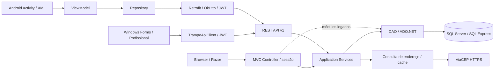
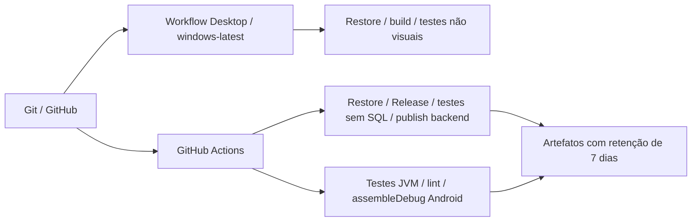
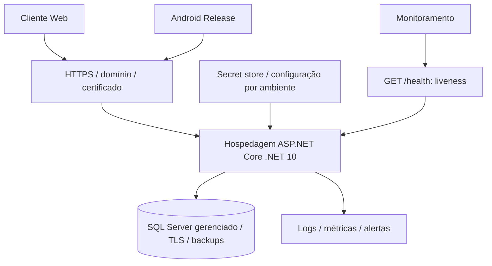

# Arquitetura final — TRAMPO

Baseline inspecionado em 26/09/2026: backend `71f16ce`, Android `ba0064b`. Projeto acadêmico ADS/PIM IV. Atualização Desktop em 11/10/2026. Esta descrição representa o código; implantação cloud é uma proposta.

## Arquitetura atual

O MVC chama os Services no mesmo processo, sem requisições HTTP à própria API. Os módulos de serviços, agendamentos, avaliações, locais/endereço e parte da conta/suporte compartilham regras. A migração é **parcial**: AdminController, PagamentoController e trechos de outros controllers ainda instanciam DAOs. Não é correto afirmar que todo o MVC já passa por Application Services.

- `Controllers/`: HTTP, sessão, formulários, Razor e tradução de erros.
- `Controllers/Api/` e `Api/Contracts/`: contratos JSON e endpoints `/api/v1`.
- `Services/`: autorização de domínio, validação, coordenação de casos de uso; `UsuarioContexto` transporta identidade sem depender de HttpContext.
- `DAO/`: SQL parametrizado, persistência, transações e revalidação sob concorrência.
- `Models/` e `Contracts/`: entidades, regras de agenda e entradas/saídas.
- `Integrations/Enderecos/`: provider de CEP e interface de geocodificação. O provider de geocodificação não produz coordenadas reais.
- Desktop `Trampo.Desktop` (projeto separado): Forms, `TrampoApiClient`, contratos JSON e sessão JWT somente em memória. Não acessa DAOs nem SQL diretamente.
- Android `app/src/main/java/com/example/trampo/`: `ui/`, `data/repository/`, `data/api/`, `data/model/`; estado observado pelas Activities, layouts XML e tema DayNight.

## Autenticação e integridade

MVC usa sessão e antiforgery global em mutações. API usa exclusivamente JWT Bearer; não usa a sessão MVC como autenticação. Assinatura HS256, issuer, audience, expiração e identidade persistida são validados. Cadastro API cria somente cliente. Os Services verificam participante/proprietário; trocar o ID na URL não concede acesso.

Desktop mantém o JWT somente em memória e o limpa no logout ou após 401. A área Windows Forms atende apenas Profissional; Android foca Cliente; Web atende Cliente, Profissional e Admin.

Android guarda apenas o token em SharedPreferences privado, excluído de backup; isso **não equivale a criptografia por Keystore**. Logout remove a sessão local. Não existe refresh token ou revogação imediata por logout/troca de senha.

Reservas e transições usam transações; notificações acompanham as mudanças de estado. Endereços físicos têm snapshot em `AgendamentoEnderecos`. Não há snapshot completo da oferta original nem de todo o cadastro do profissional.

## Infraestrutura atual

Integrações SQL e Kotlin/API/SQL rodam localmente em Windows; não estão dentro do pipeline Linux. O workflow Desktop em `windows-latest` roda somente build e testes não visuais. Resultados remotos e limitações em [DevOps e Cloud](DEVOPS-E-CLOUD.md).

## Implantação proposta — não provisionada

Uma instância é a proposta inicial. Mais instâncias exigem sessão compartilhada e persistência/compartilhamento de chaves Data Protection. `/health` não mede readiness do SQL nem disponibilidade de CEP/JWT. Proxy, TLS, backups/restauração, identidade de deploy, assinatura Android e endpoint real devem ser validados numa implantação futura. Não houve deploy cloud nesta sprint.

Fontes: [Program.cs](../Program.cs), [Services](../Services), [DAOs](../DAO), [Android](https://github.com/vinicimxt/TRAMPO-APP), [Desktop Sprint12](SPRINT-12-DESKTOP.md), [histórico da extração](Sprint3/ARQUITETURA.md), [implantação](IMPLANTACAO.md).
