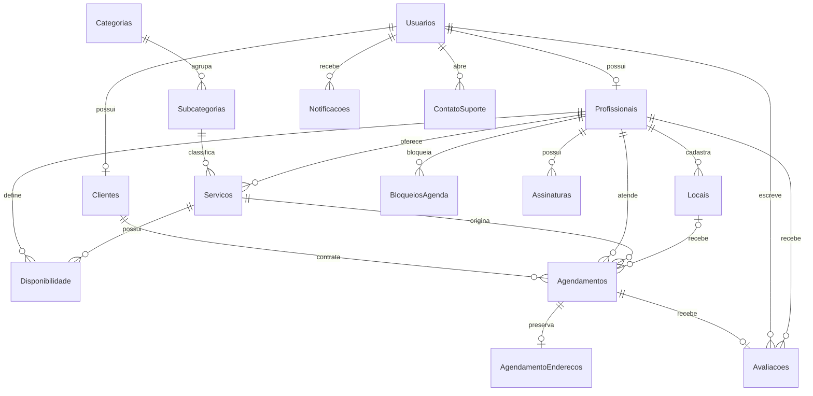

# Banco de dados — TRAMPO

Metadados consultados em 26/09/2026 no SQL Express local configurado, sem leitura de dados pessoais e sem alteração de schema. Banco físico com **15 tabelas, 20 FKs, 16 CHECKs, 20 índices (incluindo PK/UNIQUE)**. Nenhuma procedure ou trigger de negócio localizada em `sys.objects`.

## Scripts e reprodução

[ScriptBD.txt](../ScriptBD.txt) cria o banco inicial com 14 tabelas e catálogo. É script de instalação **não idempotente**, com nome de banco fixo; não executar sobre banco existente. [Migração 001](../ScriptsSQL/001_enderecos_geolocalizacao.sql) acrescenta dez colunas a Locais e cria AgendamentoEnderecos, preservando textos legados. Deve ser aplicada após a base; em banco já existente, aplicar somente migrações necessárias. A migração tem guards/transação e histórico de reexecução na Sprint 5.

O conjunto base + 001 representa as tabelas, colunas, relações e constraints inspecionadas. **ScriptBD sozinho não representa o schema final.** A revisão desta sprint comparou declarações e metadados; não recriou um banco vazio nem reaplicou migração no banco em uso. Não houve mudança estrutural para fins documentais. Nomes gerados automaticamente de PK/UQ/CHECK variam entre instalações.

Catálogo: 15 categorias e 65 subcategorias nos scripts e na consulta local. Seeds pressupõem IDs iniciais de categoria no banco recém-criado; não reexecutar INSERTs como atualização. Não há ferramenta de versionamento automático de migrações ou tabela de histórico de migração.

## MER textual final

`Servicos.LocalId → Locais.Id` é associação lógica validada pela aplicação; **não existe FK física para essa coluna** na base/script inspecionados, portanto ela não aparece como FK no MER acima. `Notificacoes.ReferenciaId` também não tem FK, pois é referência de domínio. Usuario pode ter registro Cliente e Profissional; papel de autenticação não é cardinalidade exclusiva no banco.

## Regras importantes

Email e UsuarioId em Clientes/Profissionais são únicos. CPF é único no índice filtrado para TipoDocumento='CPF'. Avaliacoes.AgendamentoId é único. Nota entre 1 e 5, modalidades, status e dia de semana possuem CHECK. Valores, autorização, horários e estados são complementados por Services/DAOs; o banco não cobre sozinho todas as regras.

Endereço estruturado valida componentes e mantém Endereco formatado para leitores legados. Coordenadas são nulas ou par válido; o geocoder atual não fornece coordenadas reais. AgendamentoEnderecos usa PK/FK AgendamentoId (0..1 por reserva), apenas Local/Domicilio, com DELETE CASCADE. Online não gera snapshot físico. Não há snapshot integral da oferta original.

Transações e bloqueios de concorrência do DAO preservam reservas/transições/notificações. A remoção de serviço pode ser desativação para preservar histórico; a FK com cascade não substitui as proteções da aplicação. Ausência de procedures/triggers deve ser apresentada como lacuna se a rubrica os exigir; não foram adicionados artificialmente.

## Dicionário físico

As tabelas abaixo foram geradas de `sys.tables`, `sys.columns`, `sys.types`, `sys.default_constraints` e metadados de chaves. Não contêm registros de usuários nem credenciais. `PK` é chave primária; `IDENTITY` é geração automática.

### AgendamentoEnderecos

| Coluna | Tipo | NULL | Chave/geração | Default |
| --- | --- | --- | --- | --- |
| AgendamentoId | int | Não | PK |  |
| CEP | char(8) | Sim |  |  |
| Logradouro | nvarchar(100) | Sim |  |  |
| Numero | nvarchar(20) | Sim |  |  |
| Complemento | nvarchar(60) | Sim |  |  |
| Bairro | nvarchar(80) | Sim |  |  |
| Cidade | nvarchar(80) | Sim |  |  |
| UF | char(2) | Sim |  |  |
| Latitude | decimal(9,6) | Sim |  |  |
| Longitude | decimal(9,6) | Sim |  |  |
| EnderecoFormatado | nvarchar(255) | Não |  |  |
| EnderecoEstruturado | bit | Não |  |  |
| Modalidade | varchar(10) | Não |  |  |

### Agendamentos

| Coluna | Tipo | NULL | Chave/geração | Default |
| --- | --- | --- | --- | --- |
| Id | int | Não | PK IDENTITY |  |
| ClienteId | int | Não |  |  |
| ProfissionalId | int | Não |  |  |
| ServicoId | int | Não |  |  |
| LocalId | int | Sim |  |  |
| Data | date | Não |  |  |
| Hora | time | Não |  |  |
| Status | nvarchar(30) | Não |  | ('Pendente') |
| Descricao | nvarchar(255) | Sim |  |  |
| EnderecoCliente | nvarchar(255) | Sim |  |  |
| DataCancelamento | datetime2 | Sim |  |  |
| ValorFinal | decimal(10,2) | Sim |  |  |
| Taxa | decimal(10,2) | Sim |  |  |
| ValorLiquido | decimal(10,2) | Sim |  |  |
| ConfirmadoProfissional | bit | Não |  | ((0)) |
| FinalizadoProfissional | bit | Não |  | ((0)) |
| ConfirmadoCliente | bit | Não |  | ((0)) |

### Assinaturas

| Coluna | Tipo | NULL | Chave/geração | Default |
| --- | --- | --- | --- | --- |
| Id | int | Não | PK IDENTITY |  |
| ProfissionalId | int | Não |  |  |
| Plano | nvarchar(20) | Não |  |  |
| Valor | decimal(10,2) | Não |  |  |
| StatusPagamento | nvarchar(20) | Não |  |  |
| MetodoPagamento | nvarchar(20) | Sim |  |  |
| DataCriacao | datetime2 | Não |  | (sysdatetime()) |

### Avaliacoes

| Coluna | Tipo | NULL | Chave/geração | Default |
| --- | --- | --- | --- | --- |
| Id | int | Não | PK IDENTITY |  |
| ProfissionalId | int | Não |  |  |
| UsuarioId | int | Não |  |  |
| AgendamentoId | int | Não |  |  |
| Nota | int | Não |  |  |
| Comentario | nvarchar(500) | Sim |  |  |
| Data | datetime2 | Não |  | (sysdatetime()) |

### BloqueiosAgenda

| Coluna | Tipo | NULL | Chave/geração | Default |
| --- | --- | --- | --- | --- |
| Id | int | Não | PK IDENTITY |  |
| ProfissionalId | int | Não |  |  |
| Data | date | Não |  |  |
| HoraInicio | time | Não |  |  |
| HoraFim | time | Não |  |  |
| Motivo | nvarchar(255) | Sim |  |  |

### Categorias

| Coluna | Tipo | NULL | Chave/geração | Default |
| --- | --- | --- | --- | --- |
| Id | int | Não | PK IDENTITY |  |
| Nome | nvarchar(100) | Não |  |  |

### Clientes

| Coluna | Tipo | NULL | Chave/geração | Default |
| --- | --- | --- | --- | --- |
| Id | int | Não | PK IDENTITY |  |
| UsuarioId | int | Não |  |  |
| BloqueadoAte | datetime2 | Sim |  |  |

### ContatoSuporte

| Coluna | Tipo | NULL | Chave/geração | Default |
| --- | --- | --- | --- | --- |
| Id | int | Não | PK IDENTITY |  |
| UsuarioId | int | Não |  |  |
| Tipo | nvarchar(50) | Não |  |  |
| Assunto | nvarchar(150) | Não |  |  |
| Mensagem | nvarchar(MAX) | Não |  |  |
| Status | nvarchar(30) | Não |  | ('Aberto') |
| DataCriacao | datetime2 | Não |  | (sysdatetime()) |

### Disponibilidade

| Coluna | Tipo | NULL | Chave/geração | Default |
| --- | --- | --- | --- | --- |
| Id | int | Não | PK IDENTITY |  |
| ProfissionalId | int | Não |  |  |
| ServicoId | int | Não |  |  |
| DiaSemana | int | Não |  |  |
| HoraInicio | time | Não |  |  |
| HoraFim | time | Não |  |  |
| Ativo | bit | Não |  | ((1)) |

### Locais

| Coluna | Tipo | NULL | Chave/geração | Default |
| --- | --- | --- | --- | --- |
| Id | int | Não | PK IDENTITY |  |
| ProfissionalId | int | Não |  |  |
| Nome | nvarchar(100) | Sim |  |  |
| Endereco | nvarchar(255) | Não |  |  |
| CEP | char(8) | Sim |  |  |
| Logradouro | nvarchar(100) | Sim |  |  |
| Numero | nvarchar(20) | Sim |  |  |
| Complemento | nvarchar(60) | Sim |  |  |
| Bairro | nvarchar(80) | Sim |  |  |
| Cidade | nvarchar(80) | Sim |  |  |
| UF | char(2) | Sim |  |  |
| Latitude | decimal(9,6) | Sim |  |  |
| Longitude | decimal(9,6) | Sim |  |  |
| EnderecoEstruturado | bit | Não |  | ((0)) |

### Notificacoes

| Coluna | Tipo | NULL | Chave/geração | Default |
| --- | --- | --- | --- | --- |
| Id | int | Não | PK IDENTITY |  |
| UsuarioId | int | Não |  |  |
| Titulo | nvarchar(100) | Não |  |  |
| Mensagem | nvarchar(255) | Não |  |  |
| Tipo | nvarchar(50) | Sim |  |  |
| ReferenciaId | int | Sim |  |  |
| Lida | bit | Não |  | ((0)) |
| DataCriacao | datetime2 | Não |  | (sysdatetime()) |

### Profissionais

| Coluna | Tipo | NULL | Chave/geração | Default |
| --- | --- | --- | --- | --- |
| Id | int | Não | PK IDENTITY |  |
| UsuarioId | int | Não |  |  |
| TipoDocumento | nvarchar(10) | Sim |  |  |
| Documento | nvarchar(20) | Sim |  |  |
| Contato | nvarchar(255) | Sim |  |  |
| Plano | nvarchar(20) | Não |  | ('Free') |
| StatusAssinatura | nvarchar(20) | Não |  | ('Ativo') |
| DataAssinatura | datetime2 | Sim |  |  |

### Servicos

| Coluna | Tipo | NULL | Chave/geração | Default |
| --- | --- | --- | --- | --- |
| Id | int | Não | PK IDENTITY |  |
| ProfissionalId | int | Não |  |  |
| SubcategoriaId | int | Não |  |  |
| Nome | nvarchar(100) | Não |  |  |
| Descricao | nvarchar(255) | Sim |  |  |
| LocalId | int | Sim |  |  |
| Atendimento | nvarchar(50) | Não |  |  |
| TipoPreco | nvarchar(20) | Não |  | ('Fixo') |
| PrecoBase | decimal(10,2) | Sim |  |  |
| LinkOnline | nvarchar(255) | Sim |  |  |
| Ativo | bit | Não |  | ((1)) |

### Subcategorias

| Coluna | Tipo | NULL | Chave/geração | Default |
| --- | --- | --- | --- | --- |
| Id | int | Não | PK IDENTITY |  |
| Nome | nvarchar(100) | Não |  |  |
| CategoriaId | int | Não |  |  |

### Usuarios

| Coluna | Tipo | NULL | Chave/geração | Default |
| --- | --- | --- | --- | --- |
| Id | int | Não | PK IDENTITY |  |
| Nome | nvarchar(100) | Não |  |  |
| Email | nvarchar(100) | Não |  |  |
| Senha | nvarchar(255) | Não |  |  |
| Tipo | nvarchar(20) | Não |  |  |
| Telefone | nvarchar(20) | Sim |  |  |

## Chaves estrangeiras físicas

| Origem | Destino | ON DELETE |
| --- | --- | --- |
| AgendamentoEnderecos.AgendamentoId | Agendamentos.Id | CASCADE |
| Agendamentos.ClienteId | Clientes.Id | NO_ACTION |
| Agendamentos.LocalId | Locais.Id | NO_ACTION |
| Agendamentos.ProfissionalId | Profissionais.Id | NO_ACTION |
| Agendamentos.ServicoId | Servicos.Id | CASCADE |
| Assinaturas.ProfissionalId | Profissionais.Id | CASCADE |
| Avaliacoes.AgendamentoId | Agendamentos.Id | NO_ACTION |
| Avaliacoes.ProfissionalId | Profissionais.Id | NO_ACTION |
| Avaliacoes.UsuarioId | Usuarios.Id | NO_ACTION |
| BloqueiosAgenda.ProfissionalId | Profissionais.Id | CASCADE |
| Clientes.UsuarioId | Usuarios.Id | CASCADE |
| ContatoSuporte.UsuarioId | Usuarios.Id | NO_ACTION |
| Disponibilidade.ProfissionalId | Profissionais.Id | NO_ACTION |
| Disponibilidade.ServicoId | Servicos.Id | CASCADE |
| Locais.ProfissionalId | Profissionais.Id | CASCADE |
| Notificacoes.UsuarioId | Usuarios.Id | CASCADE |
| Profissionais.UsuarioId | Usuarios.Id | CASCADE |
| Servicos.ProfissionalId | Profissionais.Id | CASCADE |
| Servicos.SubcategoriaId | Subcategorias.Id | NO_ACTION |
| Subcategorias.CategoriaId | Categorias.Id | CASCADE |

## Índices

| Tabela | Índice | Colunas | Único | PK | Filtro |
| --- | --- | --- | --- | --- | --- |
| AgendamentoEnderecos | PK_AgendamentoEnderecos | AgendamentoId | True | True |  |
| Agendamentos | PK__Agendame__3214EC07932BA4CC | Id | True | True |  |
| Assinaturas | PK__Assinatu__3214EC07283B5C4D | Id | True | True |  |
| Avaliacoes | PK__Avaliaco__3214EC077771741D | Id | True | True |  |
| Avaliacoes | UX_Avaliacoes_Agendamento | AgendamentoId | True | False |  |
| BloqueiosAgenda | PK__Bloqueio__3214EC07C8145B4B | Id | True | True |  |
| Categorias | PK__Categori__3214EC0799B8458F | Id | True | True |  |
| Clientes | PK__Clientes__3214EC075FB344E8 | Id | True | True |  |
| Clientes | UQ__Clientes__2B3DE7B929AFC260 | UsuarioId | True | False |  |
| ContatoSuporte | PK__ContatoS__3214EC07CA24DC5F | Id | True | True |  |
| Disponibilidade | PK__Disponib__3214EC07CCF14007 | Id | True | True |  |
| Locais | PK__Locais__3214EC07640EB866 | Id | True | True |  |
| Notificacoes | PK__Notifica__3214EC077C9C2D4D | Id | True | True |  |
| Profissionais | PK__Profissi__3214EC07B1EFEDD6 | Id | True | True |  |
| Profissionais | UQ__Profissi__2B3DE7B9564BA115 | UsuarioId | True | False |  |
| Profissionais | UX_Profissionais_CPF | Documento | True | False | ([TipoDocumento]='CPF') |
| Servicos | PK__Servicos__3214EC073123A419 | Id | True | True |  |
| Subcategorias | PK__Subcateg__3214EC071700ABD2 | Id | True | True |  |
| Usuarios | PK__Usuarios__3214EC070CA3AE7F | Id | True | True |  |
| Usuarios | UQ__Usuarios__A9D10534EB8D303A | Email | True | False |  |

## CHECK constraints

| Tabela | Nome | Regra SQL |
| --- | --- | --- |
| AgendamentoEnderecos | CK_AgendamentoEnderecos_Coordenadas | ([Latitude] IS NULL AND [Longitude] IS NULL OR [Latitude] IS NOT NULL AND [Longitude] IS NOT NULL AND ([Latitude]>=(-90) AND [Latitude]<=(90)) AND ([Longitude]>=(-180) AND [Longitude]<=(180))) |
| AgendamentoEnderecos | CK_AgendamentoEnderecos_Estruturado | ([EnderecoEstruturado]=(0) OR [CEP] IS NOT NULL AND NOT [CEP] like '%[^0-9]%' AND [Logradouro] IS NOT NULL AND [Numero] IS NOT NULL AND [Bairro] IS NOT NULL AND [Cidade] IS NOT NULL AND [UF] IS NOT NULL) |
| AgendamentoEnderecos | CK_AgendamentoEnderecos_Modalidade | ([Modalidade]='Domicilio' OR [Modalidade]='Local') |
| Agendamentos | CK__Agendamen__Statu__72C60C4A | ([Status]='AguardandoCliente' OR [Status]='CanceladoProfissional' OR [Status]='CanceladoCliente' OR [Status]='Cancelado' OR [Status]='Finalizado' OR [Status]='Confirmado' OR [Status]='Pendente') |
| Assinaturas | CK__Assinatur__Plano__0D7A0286 | ([Plano]='Premium' OR [Plano]='Free') |
| Assinaturas | CK__Assinatur__Statu__0E6E26BF | ([StatusPagamento]='Cancelado' OR [StatusPagamento]='Pago' OR [StatusPagamento]='Pendente') |
| Avaliacoes | CK__Avaliacoes__Nota__7C4F7684 | ([Nota]>=(1) AND [Nota]<=(5)) |
| ContatoSuporte | CK__ContatoSu__Statu__03F0984C | ([Status]='Fechado' OR [Status]='Respondido' OR [Status]='Aberto') |
| Disponibilidade | CK__Disponibi__DiaSe__693CA210 | ([DiaSemana]>=(0) AND [DiaSemana]<=(6)) |
| Locais | CK_Locais_Coordenadas | ([Latitude] IS NULL AND [Longitude] IS NULL OR [Latitude] IS NOT NULL AND [Longitude] IS NOT NULL AND ([Latitude]>=(-90) AND [Latitude]<=(90)) AND ([Longitude]>=(-180) AND [Longitude]<=(180))) |
| Locais | CK_Locais_EnderecoEstruturado | ([EnderecoEstruturado]=(0) OR [CEP] IS NOT NULL AND NOT [CEP] like '%[^0-9]%' AND [Logradouro] IS NOT NULL AND [Numero] IS NOT NULL AND [Bairro] IS NOT NULL AND [Cidade] IS NOT NULL AND [UF] IS NOT NULL) |
| Profissionais | CK__Profissio__Plano__5441852A | ([Plano]='Premium' OR [Plano]='Free') |
| Profissionais | CK__Profissio__Statu__5629CD9C | ([StatusAssinatura]='Pendente' OR [StatusAssinatura]='Cancelado' OR [StatusAssinatura]='Ativo') |
| Servicos | CK__Servicos__Atendi__619B8048 | ([Atendimento]='Online' OR [Atendimento]='Local' OR [Atendimento]='Domicilio') |
| Servicos | CK__Servicos__TipoPr__6383C8BA | ([TipoPreco]='Combinar' OR [TipoPreco]='Fixo') |
| Usuarios | CK__Usuarios__Tipo__4BAC3F29 | ([Tipo]='admin' OR [Tipo]='profissional' OR [Tipo]='cliente') |

