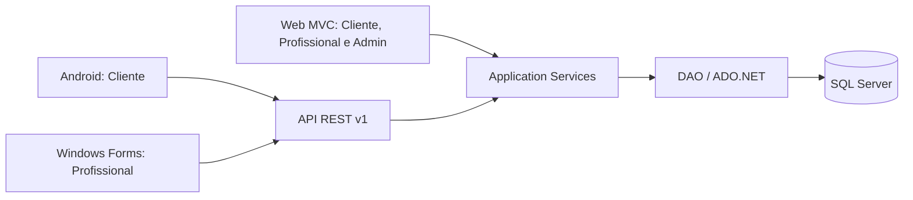

# Sprint 12 — Desktop (fechamento)

## Registro inicial de revisão — antes dos ajustes

Data: 11/10/2026. A inspeção visual manual das oito janelas foi tentada com Computer Use, mas o auxiliar de Windows não iniciou (`helper_sandbox_lock_failed`, acesso negado ao diretório de sandbox). Por isso, os itens abaixo são achados de revisão de código e ativos, não defeitos visuais observados em uma captura:

1. O executável e os Forms não configuram ícone TRAMPO; a logo PNG existente aparece somente no Login.
2. O menu principal identifica o profissional e contém as quatro ações, mas não reutiliza a logo existente.
3. As grades usam paleta e seleção semelhantes; Agendamentos usa altura de linha 40, enquanto Serviços e Locais usam 42.
4. O Login centraliza um cartão de largura fixa, e o MainForm usa um cartão com Bounds e Anchor. O comportamento em DPI alto e no tamanho mínimo depende de validação visual real.

Os itens 1–3 são ajustes de acabamento de baixo risco. O item 4 permanece para inspeção manual antes de qualquer alteração mais ampla.

## Objetivo e escopo

O aplicativo Windows Forms em .NET 10 encerra a área do **Profissional** para a entrega acadêmica. A Fase 5 fez acabamento visual, conferências não visuais, smoke de integração e documentação. Nenhuma regra de negócio ou endpoint foi alterado.

## Arquitetura e autenticação



O Desktop contém Forms, DTOs e `TrampoApiClient`. O cliente HTTP concentra rotas, JSON, Bearer e tradução de erros; os Forms não acessam SQL. O login usa `POST /api/v1/auth/login` seguido de `GET /api/v1/auth/me` e aceita apenas o perfil profissional. O JWT permanece em `UserSession` na memória e é limpo no logout ou após 401. Não há persistência de credenciais nem banco local. A URL padrão de desenvolvimento é `http://localhost:5165/` e pode ser configurada por `TRAMPO_API_BASE_URL`.

## Forms e funções

| Form | Função |
| --- | --- |
| `LoginForm` | Login profissional, mensagens de validação e retorno após logout |
| `MainForm` | Nome do profissional e menu Agendamentos, Serviços, Locais e Sair |
| `AgendamentosForm` | Lista recebida, atualização e acesso ao detalhe |
| `DetalheAgendamentoForm` | Dados do pedido, confirmar, recusar e finalizar conforme estado |
| `ServicosForm` | Lista própria, cadastro, edição e remoção/desativação |
| `ServicoForm` | Dados, categoria, local e disponibilidade do serviço |
| `LocaisForm` | Lista, endereço formatado, cadastro, edição e exclusão |
| `LocalForm` | Endereço estruturado e busca de CEP pela API, com preenchimento manual |

Todas as chamadas HTTP usam `async/await`. Os Forms bloqueiam ações durante as mutações e mostram confirmação ou mensagem amigável. O cliente converte erro de conexão e timeout em `ApiException`; 401 limpa a sessão e retorna ao Login. As grades são somente leitura, usam seleção por linha e cabeçalho/paleta TRAMPO.

## Endpoints consumidos

| Área | Rotas |
| --- | --- |
| Autenticação | `POST /api/v1/auth/login`, `GET /api/v1/auth/me` |
| Agendamentos | `GET /api/v1/agendamentos?visao=recebidos`, `GET /api/v1/agendamentos/{id}`, `POST /api/v1/agendamentos/{id}/confirmar`, `/recusar`, `/finalizar` |
| Serviços | `GET /api/v1/servicos/me`, `GET /api/v1/servicos/{id}`, `POST /api/v1/servicos`, `PUT /api/v1/servicos/{id}`, `DELETE /api/v1/servicos/{id}`, `GET /api/v1/categorias` |
| Locais e CEP | `GET/POST /api/v1/locais`, `GET/PUT/DELETE /api/v1/locais/{id}`, `GET /api/v1/enderecos/cep/{cep}` |

Os Services da API fazem validação e ownership. A consulta CEP passa pelo backend; falha permite edição manual. Um local vinculado a serviço ou agendamento não é excluído (409).

## Ajustes de acabamento

- Gerado `Assets/Trampo.ico` da logo original, com tamanhos de 16 a 256 pixels. O ícone é configurado no executável e nos oito Forms, inclusive no diálogo de valor final.
- A logo PNG original passou a ser recurso incorporado, usado no Login e uma vez no menu principal. A execução não depende de arquivo externo da marca.
- A grade de Agendamentos passou a usar altura de linha 42, igual às de Serviços e Locais.
- As cores, botões, títulos, fundos e seleção das grades existentes foram preservados. Não houve transformação geral da UI.

## Validação e resultados

| Verificação | Resultado |
| --- | --- |
| Build Debug e Release Desktop | zero erros e zero avisos |
| Testes não visuais Desktop | 70 verificações passaram |
| Tamanho mínimo | Login, menu principal e rodapés dos seis Forms internos passaram em verificações de limites dos controles |
| Smoke real Fase 4 | login, CEP, CRUD de local e limpeza de fixture: passou |
| Smoke real Fase 5 | login, Agendamentos, Serviços, Locais e logout via `TrampoApiClient` contra API local: passou |
| Fixture Fase 5 | profissional temporário identificado por tag; removido ao final; módulos retornaram listas vazias |
| Evidência visual enviada pelo usuário em 12/10/2026 | Login, MainForm, AgendamentosForm e ServicosForm conferidos nas quatro capturas; sem cortes aparentes na resolução exibida |
| Screenshots no repositório | nenhum; as quatro capturas foram enviadas na conversa e não foram publicadas como artefatos |

O smoke Fase 5 executou chamadas reais de cada módulo em API local isolada na porta 5178; ele **não** simula cliques nos Forms. A navegação entre janelas é coberta apenas por inspeção de código e verificações não visuais. O ícone, logo, botões e limites em tamanho mínimo foram instanciados em STA no runner de testes.

O auxiliar de validação visual retornou `helper_sandbox_lock_failed` com acesso negado ao diretório de sandbox em duas tentativas, incluindo reinicialização da sessão. Em 12/10/2026, o usuário enviou quatro capturas reais: Login, MainForm, AgendamentosForm e ServicosForm. Elas mostram a identidade TRAMPO, os itens Agendamentos/Serviços/Locais/Sair, uma grade vazia de agendamentos e uma linha de serviço, sem cortes aparentes na resolução exibida. A sequência MainForm → Agendamentos e MainForm → Serviços aparece nas capturas. As imagens não mostram DetalheAgendamentoForm, ServicoForm, LocaisForm ou LocalForm, nem redimensionamento, MessageBoxes, 401, logout ou o CRUD visual. As capturas incluem ambiente externo ao aplicativo e nome do profissional; não foram copiadas para a documentação pública sem revisão de privacidade.

## CI

O projeto Desktop possui workflow próprio `.github/workflows/desktop.yml` em `windows-latest`: restore, build Release e runner não visual. Não foi incluído no pipeline Linux do backend. A solução passou a incluir o projeto de testes. Restore, build Release e 70 verificações passaram localmente com os mesmos comandos do workflow; não há execução remota confirmada nesta fase.

Para executar localmente no diretório `Trampo.Desktop`:

```powershell
dotnet restore Trampo.Desktop.slnx
dotnet build Trampo.Desktop.slnx --configuration Release --no-restore
dotnet run --project Tests/Trampo.Desktop.Tests/Trampo.Desktop.Tests.csproj --configuration Release --no-build
```

## Limitações e decisão de apresentação

Desktop atende somente Profissional; Cliente usa Android ou Web, e Admin usa Web. Não há token persistido, banco local, SQL direto, mapas, pagamento, chat ou atualização automática. As ações dependem de API e SQL Server disponíveis.

**GO para demonstrar Login, painel, listagem de Agendamentos e listagem de Serviços** na resolução mostrada. **A validação visual completa das oito janelas ainda não está demonstrada**: faltam evidências das telas Detalhe, Serviço, Locais e Local e dos estados de redimensionamento e mensagens. Build, testes não visuais e smokes de API passaram; as quatro capturas recebidas ainda exigem revisão de privacidade antes de publicação.
