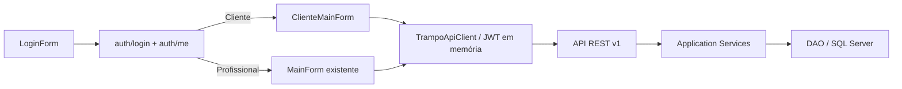

# Sprint 13 — Desktop Cliente e Profissional

Estado do código em 06/11/2026. A [Sprint 12](SPRINT-12-DESKTOP.md) permanece como registro histórico da primeira área Desktop, exclusiva do Profissional. Esta evolução acrescenta o Cliente e preserva o painel e os Forms profissionais.

## Arquitetura

Admin recebe orientação para usar a Web. O Desktop não conhece connection string, não acessa SQL e não usa IDs de proprietário para autorizar ações. 401 limpa sessão e fecha Forms protegidos; 403 mantém sessão e mostra mensagem. Logout remove JWT, perfil, ID e nome da memória. Chamadas HTTP continuam assíncronas.

As páginas Cliente identificam campos e ações para acessibilidade, aceitam Enter na ação principal de busca e Escape para voltar. A revisão visual e de navegação por teclado no Windows ainda é necessária.

## Recursos Cliente implementados

| Área | Desktop | API |
| --- | --- | --- |
| Busca | Texto, modalidade, categoria, subcategoria, profissional; paginação | `GET /servicos`, `GET /categorias` |
| Serviço | Nome, profissional, classificação, modalidade, descrição, preço atual, média e total de avaliações | `GET /servicos/{id}` |
| Disponibilidade | Data e horários retornados pelo servidor | `GET /servicos/{id}/agenda` |
| Reserva | Resumo antes do envio, endereço estruturado para Domicílio, observações, CEP auxiliar | `POST /agendamentos`, `GET /enderecos/cep/{cep}` |
| Pedidos | Lista, detalhe, status, modalidade, endereço, cancelamento e confirmação de conclusão conforme estado | `GET /agendamentos`, `GET /agendamentos/{id}`, `POST /cancelar`, `POST /confirmar-conclusao` |
| Avaliar | Nota 1–5 e comentário opcional quando API informa elegibilidade | `GET/POST /agendamentos/{id}/avaliacao` |
| Conta | Nome/telefone, email somente leitura, troca de senha | `GET/PUT /perfil`, `PUT /perfil/senha` |
| Notificações | Lista paginada e marcação de leitura | `GET /notificacoes`, `POST /notificacoes/{id}/ler` |
| Suporte | Envio e consulta dos próprios chamados/status | `POST/GET /suporte` |

O menu Avaliações abre os atendimentos finalizados; cada detalhe consulta a elegibilidade. Não se afirma existir lista REST das avaliações já enviadas. Os Forms do Profissional preservam confirmar, recusar, finalizar, CRUD de serviços e locais; a lista/detalhe de agendamento agora usa nomes fornecidos pelo contrato de participante.

## Mudanças mínimas na API

- `GET /servicos` ganhou filtros opcionais `categoriaId`, `subcategoriaId` e `profissional`, aplicados no SQL antes da paginação. Campos existentes e chamadas antigas permanecem válidos.
- `ServicoResponse` ganhou `mediaAvaliacoes` e `totalAvaliacoes`, agregados por profissional, sem nome ou comentário de avaliador.
- `GET /suporte` foi acrescentado para o Cliente autenticado. O Service deriva `UsuarioId` do JWT; o DAO filtra por ele. A leitura removida de `conn.Open()` evita abrir novamente uma conexão já aberta por `Conexao.Conectar()`.
- O contrato de agendamento já ampliado nesta árvore inclui nome do serviço e participantes, usado por Android e Desktop.
- Nenhum endpoint de comentários públicos foi acrescentado. A revisão automática recusou a proposta de expor nomes e textos anonimamente; seguir somente com agregados foi a alternativa segura.

## Validação executada

| Verificação | Resultado |
| --- | --- |
| Desktop Debug e Release | 0 erros, 0 avisos |
| Runner Desktop Release | 124 verificações passaram, incluindo 70 anteriores do Profissional |
| Backend Debug e Release | 0 erros; Release com 109 avisos de nulabilidade preexistentes |
| Contrato HTTP isolado | Nomes no agendamento e média/quantidade no catálogo passaram |
| Smoke API Release isolada, porta 5178 | Catálogo e categorias 200; filtros consultaram SQL; suporte/agendamentos sem JWT 401; catálogo real serializou média/quantidade |
| Limpeza de smoke | Processo temporário encerrado; nenhuma fixture criada |
| Smoke autenticado Cliente/Profissional e cliques WinForms | Não executado: ambiente não possui credenciais de fixture e não foi criado usuário permanente |

O build não foi implantado nem substituiu a API de desenvolvimento na porta 5165, que continuou respondendo HTTP 200 em 06/11/2026. O processo temporário de smoke na porta 5178 foi encerrado. Não houve commit, push ou tag. Para observar as mudanças no aplicativo em execução, é preciso iniciar o Desktop recompilado e reiniciar a API com esta versão após a revisão.

## Limites e revisão manual

- Comentários individuais e nomes de avaliadores não são enviados pela API; o Desktop mostra somente média e quantidade reais. A lista de avaliações já enviadas e um perfil público profissional completo não têm contrato REST.
- A tabela de suporte armazena mensagem e status, sem coluna de texto de resposta. O Desktop não exibe resposta inexistente.
- O endereço de um local profissional não consta no catálogo público; o detalhe do pedido mostra o endereço persistido após a reserva. O preço atual exibido no catálogo e no resumo não é apresentado como preço histórico contratado.
- Verificar visualmente em Windows: login dos dois perfis, layout em DPI/tamanho mínimo, navegação por teclado, busca, reserva e ações controladas com contas de teste. Repetir 401/403 reais e regressão profissional completa antes da aceitação final.
- O código Android atual possui telas Cliente e Profissional, mas há chamadas para avaliações públicas/recebidas ainda sem rota REST e telas profissionais de conta/comunicação ligadas a rotas restritas ao Cliente. A [matriz](MATRIZ-WEB-API-MOBILE.md) e o README Android registram isso.

**Estado para revisão:** REVISÃO NECESSÁRIA. Os builds e testes não visuais passaram, mas faltam smoke autenticado e validação visual manual; comentários públicos exigem decisão explícita de privacidade.
